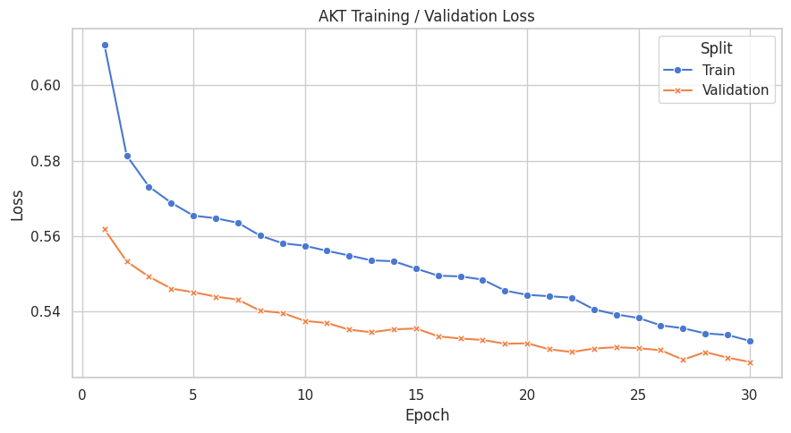
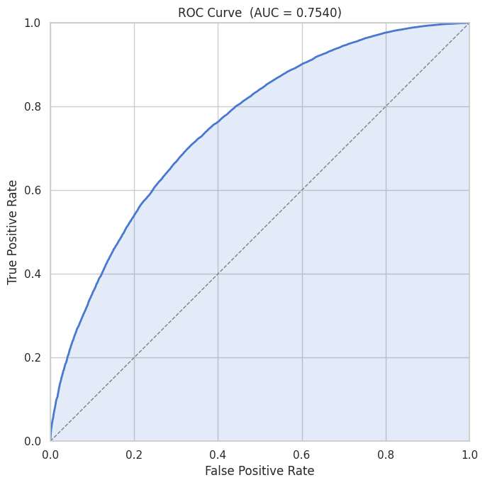
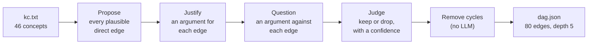
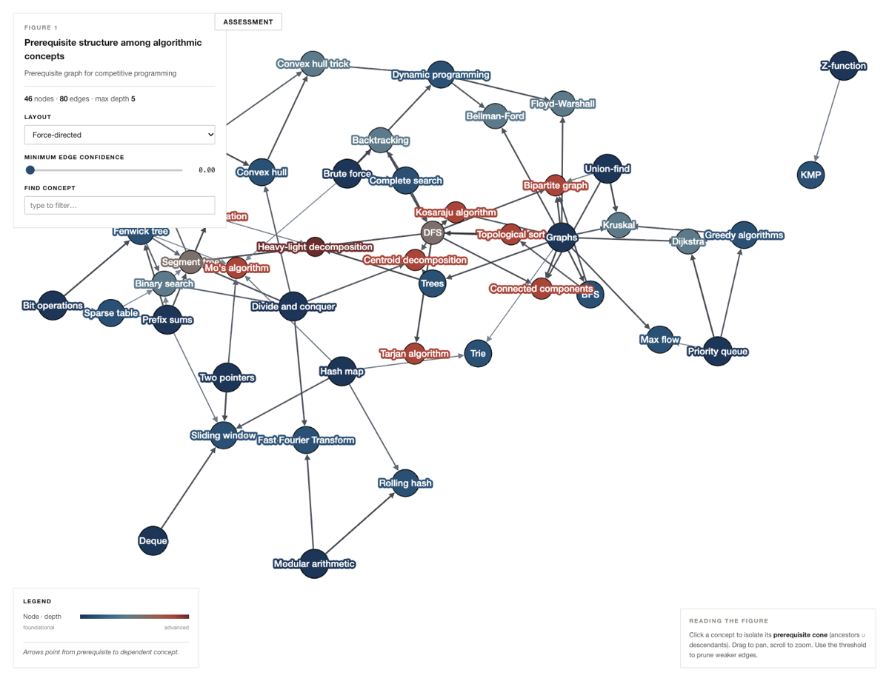

# Learn-CP-PSC

Experiments for our PSC (collective scientific project) at École Polytechnique, 2025-2026, supervised by Dr. Jill-Jênn Vie (Inria): an assistant to learn competitive programming, which keeps track of what a student knows and recommends what to work on next.

The repository has four independent parts.

## Knowledge tracing with AKT

**Task.** A student's history is a sequence of interactions $(q_t, c_t, r_t)$: a question, its concept, and whether the answer was correct. Given the past interactions and the next pair $(q_t, c_t)$, the model predicts the probability that $r_t = 1$.

[`AKT/`](AKT/akt_pytorch_implementation.ipynb) is my from-scratch PyTorch implementation of Attentive Knowledge Tracing ([Ghosh, Heffernan and Lan, KDD 2020](https://doi.org/10.1145/3394486.3403282)).

**Embeddings.** Questions and interactions are embedded with a Rasch-like factorization, where $\mu_q$ is a scalar per question and the other terms are vectors per concept or response:

```math
x_t = c_{c_t} + \mu_{q_t} d_{c_t}, \qquad y_t = c_{c_t} + g_{r_t} + \mu_{q_t} f_{c_t, r_t}
```

So the 17,751 questions only cost one parameter each. Two self-attention encoders turn these into contextualized $\hat x_t$ and $\hat y_t$.

**Monotonic attention.** The knowledge retriever attends from the current question to the past interactions $\tau$ (strictly before $t$), with queries and keys from $\hat x$ and values from $\hat y$. To model forgetting, the scores decay with a context-aware distance:

```math
s_{t,\tau} = \frac{Q_t^\top K_\tau}{\sqrt{m}} \, e^{-\theta d(t,\tau)}, \qquad d(t,\tau) = \sqrt{(t - \tau) \sum_{i=\tau+1}^{t} \alpha'_{t,i}}
```

where $\theta$ is a learnt positive parameter and $\alpha'$ are the attention weights before the decay. Interactions that are both far in time and unrelated to the current question are downweighted the most.

**Prediction.** The retrieved knowledge state is concatenated with $\hat x_t$ and goes through an MLP and a sigmoid. The loss is the binary cross-entropy over the non-padded positions.

**Setup.** ASSISTments 2009 (17,751 questions, 149 concepts), split by student into 72% train, 8% validation and 20% test, in windows of 200 interactions. Adam, learning rate 3e-4, batch size 24, 30 epochs.

| | Mine | AKT paper |
| --- | --- | --- |
| Embedding dimension | 32 | 128 to 256 |
| Attention heads | 8 | 8 |
| Sequence length | 200 | 200 |
| Dropout | 0.2 | 0.2 |
| Parameters | 236,512 | |
| **Test AUC** | **0.754** | 0.835 |

**Results.** On the 833 test students, never seen in training, the model reaches an AUC of 0.754 and an accuracy of 0.730. This is below the 0.835 of the paper, which is consistent with an embedding 4 to 8 times smaller and no hyperparameter tuning.

<p align="center">
  
  
</p>

## Prerequisite graph

[`Prerequisite-graph/`](Prerequisite-graph) builds a graph of which concept has to be learnt before which, from a flat list of 46 concepts ([`kc.txt`](Prerequisite-graph/kc.txt)). It is an adversarial pipeline of four LLM calls written with LangGraph:



The last step is deterministic: it drops the least confident edge of each remaining cycle, so the result is always a DAG. [`dag.json`](Prerequisite-graph/dag.json) keeps the arguments for and against each edge.

<p align="center">
  <a href="https://mounirlbath.github.io/cp-prerequisite-graph/"></a>
  <br>
  <em>The prerequisite graph between competitive programming concepts (<a href="https://mounirlbath.github.io/cp-prerequisite-graph/">interactive version</a>).</em>
</p>

## Dynamic cognitive diagnosis

Goal: find which concepts a student masters with as few questions as possible. A knowledge state is a set of concepts closed under prerequisites (an order ideal of the prerequisite poset).

As in a binary search, the best concept to ask is the one contained in half of the possible states. [Linial and Saks (1985)](https://doi.org/10.1016/0097-3165%2885%2990087-1) proved there is always a concept $x$ whose proportion of states $p(x)$ is close enough to it:

```math
\delta \le p(x) \le 1 - \delta, \qquad \delta = \frac{3 - \log_2 5}{4} \approx 0.17
```

so $\Theta(\log N)$ questions are enough for $N$ possible states, which is optimal.

Counting the states exactly is #P-complete, so [our implementation](Dynamic-cognitive-diagnosis/mcmc_ideals.ipynb) estimates $p$ with a Markov chain: pick a random concept, and add it or remove it if the set stays a valid state. The chain converges to the uniform distribution, and we ask the concept whose estimated $p$ is closest to $1/2$.

## CF-Tracker

[`CF-Tracker/`](CF-Tracker) is a Django web app for [Codeforces](https://codeforces.com) users. It fetches the submissions of a handle through the Codeforces API, shows statistics per tag, and recommends problems:

- a simple rule: an unsolved problem rated just above the level of the user (overall or on a chosen tag);
- three models from [Mangaki](https://research.mangaki.fr/), in [`cf_recommender.py`](CF-Tracker/cf_recommender.py): collaborative filtering with nearest neighbours, matrix factorization trained by SGD, and a LASSO regression on the problem tags.

See its [README](CF-Tracker/README.md) to run it.
